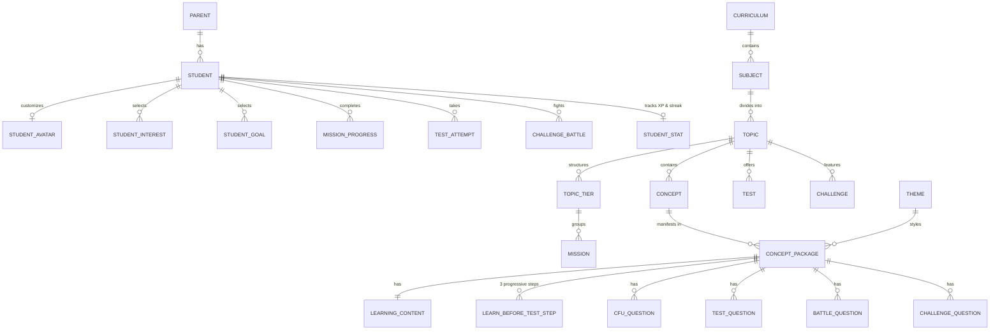

# Kidsverse Complete API Reference & Master Documentation

The complete, authoritative API specification for the entire **Kidsverse Platform**. This document covers:
1. **Core Application APIs**: Parent Accounts, Student Onboarding, Avatar Customization, Learning Missions, Journey World Map, Testing System, 1v1 Challenge Battles, Gamification, and Profile.
2. **Curriculum & Content Studio Ingestion APIs**: Content package feed ingestion with relational table segregation, 3-step Learn Before Test flow (`understand` $\rightarrow$ `example` $\rightarrow$ `remember`), automated mission synchronization, and dynamic curriculum authoring management.

Base URL: `http://localhost:8000/api/v1`

---

## Table of Contents
- [1. System Architecture & Relational Model](#1-system-architecture--relational-model)
- [2. Security, Authentication & Gamification](#2-security-authentication--gamification)
- [3. Complete Endpoints Master Index](#3-complete-endpoints-master-index)
- [4. Core Application APIs](#4-core-application-apis)
  - [4.1. Auth & Parent Accounts](#41-auth--parent-accounts)
  - [4.2. Students & Onboarding](#42-students--onboarding)
  - [4.3. Avatar Customization Catalog](#43-avatar-customization-catalog)
  - [4.4. Interests & Goals Catalogs](#44-interests--goals-catalogs)
  - [4.5. Nova AI Greeting & Onboarding Completion](#45-nova-ai-greeting--onboarding-completion)
  - [4.6. Student Home Screen](#46-student-home-screen)
  - [4.7. Learn, Curriculum Tiers & Missions](#47-learn-curriculum-tiers--missions)
  - [4.8. 2D Journey Map & Companion Activities](#48-2d-journey-map--companion-activities)
  - [4.9. Testing System & Adaptive Practice](#49-testing-system--adaptive-practice)
  - [4.10. Boss Challenges & 1v1 Arena Battles](#410-boss-challenges--1v1-arena-battles)
  - [4.11. Student Profile, Journey Metrics & Collectible Cards](#411-student-profile-journey-metrics--collectible-cards)
- [5. Curriculum & Content Studio Ingestion APIs](#5-curriculum--content-studio-ingestion-apis)
  - [5.1. Ingest Content Feed (`POST /admin/content/feed`)](#51-ingest-content-feed-post-admincontentfeed)
  - [5.2. List & Filter Content Packages (`GET /admin/content/packages`)](#52-list--filter-content-packages-get-admincontentpackages)
  - [5.3. Content Package Detail Reconstructed (`GET /admin/content/packages/{id}`)](#53-content-package-detail-reconstructed-get-admincontentpackagesid)
  - [5.4. Dynamic Curriculum Hierarchy Tree (`GET /curriculum/tree`)](#54-dynamic-curriculum-hierarchy-tree-get-curriculumtree)
  - [5.5. Curriculum Management APIs](#55-curriculum-management-apis)
  - [5.6. Topic & Concept Authoring APIs](#56-topic--concept-authoring-apis)
  - [5.7. Themes Management APIs](#57-themes-management-apis)
- [6. End-to-End Testing via cURL](#6-end-to-end-testing-via-curl)

---

## 1. System Architecture & Relational Model

The Kidsverse backend is built with Django REST Framework backed by PostgreSQL, segregating curriculum authoring, student gamification, and assessment engines into dedicated relational tables.



---

## 2. Security, Authentication & Gamification

### Authentication
Parent endpoints require a standard Bearer Token:
```http
Authorization: Bearer <jwt_token>
```
The token contains the encrypted `parent_id` payload, validated on every authenticated request by [`JWTAuthentication`](file:///C:/Users/admin/Desktop/kidsverse/api/authentication.py).

### Middleware Ownership Guard
[`StudentOwnershipMiddleware`](file:///C:/Users/admin/Desktop/kidsverse/api/middleware.py) intercepts all requests containing `/students/{studentId}/...`. It verifies that the authenticated parent is the legitimate guardian of the student, returning HTTP 403 `FORBIDDEN` if a mismatch is detected.

### Gamification & Streak Math
When a student completes a mission, test, or challenge battle:
1. `total_xp` is updated server-side.
2. `day_streak` automatically advances if the student was active yesterday, resets if a day was skipped, or stays at 1 for newly registered accounts.
3. Student level is dynamically derived:
   $$\text{level} = 1 + \left\lfloor \frac{\text{total\_xp}}{1000} \right\rfloor$$

---

## 3. Complete Endpoints Master Index

| # | Method | Path | Auth | Tag |
|---|---|---|---|---|
| 1 | `POST` | `/api/v1/auth/parent/signup` | Public | Auth |
| 2 | `POST` | `/api/v1/auth/parent/login` | Public | Auth |
| 3 | `POST` | `/api/v1/auth/parent/logout` | Bearer | Auth |
| 4 | `GET` | `/api/v1/parent/me` | Bearer | Parent |
| 5 | `GET` | `/api/v1/parent/students` | Bearer | Parent |
| 6 | `GET` | `/api/v1/parent/overview` | Bearer | Parent |
| 7 | `POST` | `/api/v1/students` | Bearer | Onboarding |
| 8 | `PATCH` | `/api/v1/students/{studentId}/grade-board` | Bearer | Onboarding |
| 9 | `GET` | `/api/v1/avatar/characters` | Public | Avatar |
| 10 | `GET` | `/api/v1/avatar/items` | Public | Avatar |
| 11 | `PUT` | `/api/v1/students/{studentId}/avatar` | Bearer | Avatar |
| 12 | `GET` | `/api/v1/interests` | Public | Interests |
| 13 | `PUT` | `/api/v1/students/{studentId}/interests` | Bearer | Interests |
| 14 | `GET` | `/api/v1/goals` | Public | Goals |
| 15 | `PUT` | `/api/v1/students/{studentId}/goals` | Bearer | Goals |
| 16 | `POST` | `/api/v1/students/{studentId}/onboarding/steps/{stepKey}/complete` | Bearer | Onboarding |
| 17 | `GET` | `/api/v1/students/{studentId}/onboarding/status` | Bearer | Onboarding |
| 18 | `POST` | `/api/v1/students/{studentId}/nova/greet` | Bearer | Onboarding |
| 19 | `GET` | `/api/v1/students/{studentId}/home` | Bearer | Home |
| 20 | `GET` | `/api/v1/students/{studentId}/subjects` | Bearer | Learn |
| 21 | `GET` | `/api/v1/subjects/{subjectId}/topics` | Public | Learn |
| 22 | `GET` | `/api/v1/students/{studentId}/topics/{topicId}` | Bearer | Learn |
| 23 | `GET` | `/api/v1/missions/{missionId}` | Public | Missions |
| 24 | `POST` | `/api/v1/students/{studentId}/missions/{missionId}/start` | Bearer | Missions |
| 25 | `POST` | `/api/v1/students/{studentId}/missions/{missionId}/complete` | Bearer | Missions |
| 26 | `GET` | `/api/v1/students/{studentId}/journey` | Bearer | Journey |
| 27 | `POST` | `/api/v1/students/{studentId}/companion-activities/{activityId}/complete` | Bearer | Journey |
| 28 | `GET` | `/api/v1/topics/{topicId}/tests` | Public | Tests |
| 29 | `GET` | `/api/v1/tests/{testId}` | Public | Tests |
| 30 | `POST` | `/api/v1/students/{studentId}/tests/{testId}/attempts` | Bearer | Tests |
| 31 | `GET` | `/api/v1/tests/attempts/{attemptId}/questions/{order}` | Public | Tests |
| 32 | `POST` | `/api/v1/tests/attempts/{attemptId}/answers` | Public | Tests |
| 33 | `POST` | `/api/v1/tests/attempts/{attemptId}/complete` | Public | Tests |
| 34 | `GET` | `/api/v1/tests/attempts/{attemptId}/result` | Public | Tests |
| 35 | `GET` | `/api/v1/challenges` | Public | Challenges |
| 36 | `GET` | `/api/v1/challenges/{challengeId}/opponents` | Public | Challenges |
| 37 | `GET` | `/api/v1/challenges/{challengeId}/preview` | Public | Challenges |
| 38 | `POST` | `/api/v1/students/{studentId}/challenge-battles` | Bearer | Challenges |
| 39 | `POST` | `/api/v1/challenge-battles/{battleId}/complete` | Public | Challenges |
| 40 | `GET` | `/api/v1/challenge-battles/{battleId}/result` | Public | Challenges |
| 41 | `GET` | `/api/v1/students/{studentId}/profile` | Bearer | Profile |
| 42 | `GET` | `/api/v1/students/{studentId}/profile/our-journey` | Bearer | Profile |
| 43 | `GET` | `/api/v1/students/{studentId}/profile/cards` | Bearer | Profile |
| 44 | `POST` | `/api/v1/admin/content/feed` | Public | Ingestion |
| 45 | `GET` | `/api/v1/admin/content/packages` | Public | Ingestion |
| 46 | `GET` | `/api/v1/admin/content/packages/{packageId}` | Public | Ingestion |
| 47 | `GET` | `/api/v1/curriculum/tree` | Public | Curriculum |
| 48 | `GET` | `/api/v1/curriculums` | Public | Curriculum |
| 49 | `POST` | `/api/v1/curriculums` | Public | Curriculum |
| 50 | `GET` | `/api/v1/curriculums/{curriculumId}` | Public | Curriculum |
| 51 | `POST` | `/api/v1/curriculums/{curriculumId}/subjects` | Public | Curriculum |
| 52 | `POST` | `/api/v1/topics/{topicId}/concepts` | Public | Curriculum |
| 53 | `GET` | `/api/v1/themes` | Public | Themes |
| 54 | `POST` | `/api/v1/themes` | Public | Themes |

---

## 4. Core Application APIs

### 4.1. Auth & Parent Accounts

#### `POST /api/v1/auth/parent/signup`
Creates a parent account and generates authentication token.
- **Request Body**:
```json
{
  "email": "parent@example.com",
  "password": "SecurePassword123!",
  "full_name": "Priya Sharma",
  "phone": "+91-9876543210"
}
```
- **Response (`201 Created`)**:
```json
{
  "parent": {
    "id": "a1b2c3d4-e5f6-7a8b-9c0d-1e2f3a4b5c6d",
    "email": "parent@example.com",
    "full_name": "Priya Sharma",
    "phone": "+91-9876543210",
    "created_at": "2026-09-26T09:00:00Z",
    "last_login_at": null
  },
  "token": "eyJhbGciOiJIUzI1NiIsInR5cCI6IkpXVCJ9..."
}
```

#### `POST /api/v1/auth/parent/login`
Authenticates parent credentials.
- **Request Body**:
```json
{
  "email": "parent@example.com",
  "password": "SecurePassword123!"
}
```
- **Response (`200 OK`)**:
```json
{
  "parent": {
    "id": "a1b2c3d4-e5f6-7a8b-9c0d-1e2f3a4b5c6d",
    "email": "parent@example.com",
    "full_name": "Priya Sharma",
    "phone": "+91-9876543210"
  },
  "token": "eyJhbGciOiJIUzI1NiIsInR5cCI6IkpXVCJ9..."
}
```

#### `GET /api/v1/parent/overview`
Provides parent monitoring dashboard summarizing children's streak, XP, subject progress, and recent scores.
- **Headers**: `Authorization: Bearer <token>`
- **Response (`200 OK`)**:
```json
{
  "students": [
    {
      "student_id": "7fa8e1b2-c012-45e3-9876-543210fedcba",
      "name": "Aarav",
      "day_streak": 4,
      "total_xp": 890,
      "subjects": [
        { "subject": "Mathematics", "progress_percent": 50 },
        { "subject": "Science", "progress_percent": 30 }
      ],
      "recent_test_score": 85.0
    }
  ]
}
```

---

### 4.2. Students & Onboarding

#### `POST /api/v1/students`
Initializes child profile (Step 1).
- **Headers**: `Authorization: Bearer <token>`
- **Request Body**: `{"name": "Aarav"}`
- **Response (`201 Created`)**:
```json
{
  "id": "7fa8e1b2-c012-45e3-9876-543210fedcba",
  "parent_id": "a1b2c3d4-e5f6-7a8b-9c0d-1e2f3a4b5c6d",
  "name": "Aarav",
  "onboarding_completed_at": null,
  "created_at": "2026-09-26T09:10:00Z"
}
```

#### `PATCH /api/v1/students/{studentId}/grade-board`
Selects grade and syllabus board (Step 2).
- **Headers**: `Authorization: Bearer <token>`
- **Request Body**:
```json
{
  "grade": "Grade 4",
  "board": "CBSE"
}
```
- **Response (`200 OK`)**:
```json
{
  "id": "7fa8e1b2-c012-45e3-9876-543210fedcba",
  "name": "Aarav",
  "grade": "Grade 4",
  "board": "CBSE"
}
```

---

### 4.3. Avatar Customization Catalog

#### `GET /api/v1/avatar/characters`
Returns character archetypes.
- **Response (`200 OK`)**:
```json
{
  "characters": [
    {
      "id": "char-1111-2222-3333-4444-555555555555",
      "slug": "explorer-boy",
      "name": "Explorer Boy",
      "base_image_url": "https://assets.kidsverse.app/avatars/boy.png"
    }
  ]
}
```

#### `PUT /api/v1/students/{studentId}/avatar`
Saves child avatar configuration (Step 3).
- **Headers**: `Authorization: Bearer <token>`
- **Request Body**:
```json
{
  "character_id": "char-1111-2222-3333-4444-555555555555",
  "outfit_item_id": "item-1111-2222-3333-4444-555555555555",
  "hair_item_id": null,
  "accessory_item_id": null
}
```

---

### 4.4. Interests & Goals Catalogs

#### `PUT /api/v1/students/{studentId}/interests`
Sets student interest topics (Space, Animals, Nature, etc.).
- **Headers**: `Authorization: Bearer <token>`
- **Request Body**:
```json
{
  "interest_ids": ["interest-uuid-1", "interest-uuid-2"]
}
```

#### `PUT /api/v1/students/{studentId}/goals`
Sets academic goals.
- **Headers**: `Authorization: Bearer <token>`
- **Request Body**:
```json
{
  "goal_ids": ["goal-uuid-1"]
}
```

---

### 4.5. Nova AI Greeting & Onboarding Completion

#### `POST /api/v1/students/{studentId}/nova/greet`
Nova introduces herself and marks onboarding as 100% complete.
- **Headers**: `Authorization: Bearer <token>`
- **Response (`200 OK`)**:
```json
{
  "message": "Hey Aarav! I'm Nova, your AI learning companion!",
  "onboarding_completed_at": "2026-09-26T09:25:00Z"
}
```

---

### 4.6. Student Home Screen

#### `GET /api/v1/students/{studentId}/home`
Returns daily active streak, XP, current level, smart recommendation, and subject roadmap.
- **Headers**: `Authorization: Bearer <token>`
- **Response (`200 OK`)**:
```json
{
  "greeting": "Ready for today's adventure, Aarav?",
  "stats": {
    "day_streak": 4,
    "total_xp": 890,
    "level": 1
  },
  "recommended_mission": {
    "mission_id": "727a3c31-1ee7-4560-bfdf-793ca0a831e5",
    "title": "Equivalent Fractions",
    "subject": "Mathematics",
    "topic": "Fractions",
    "duration_minutes": 8,
    "reason": "Continue your journey in Fractions!",
    "xp_reward": 30,
    "progress_percent": 0
  },
  "subjects": [
    {
      "id": "78794c48-fb9e-4e6f-a89c-851912442cf2",
      "name": "Mathematics",
      "slug": "mathematics",
      "icon_asset": "https://assets.kidsverse.app/subjects/math.png",
      "is_unlocked": true,
      "topics_count": 8
    }
  ]
}
```

---

### 4.7. Learn, Curriculum Tiers & Missions

#### `GET /api/v1/students/{studentId}/topics/{topicId}`
Topic roadmap showing syllabus tiers (School Syllabus, Advanced, Olympiad) and interactive mission nodes with star ratings.
- **Headers**: `Authorization: Bearer <token>`
- **Response (`200 OK`)**:
```json
{
  "id": "060d5b51-ce0b-4171-8ecb-99d63897f2ca",
  "name": "Fractions",
  "grade_level": "Grade 4",
  "subject": "Mathematics",
  "description": "Understand fractions as parts of a whole",
  "tiers": [
    {
      "tier_key": "school_syllabus",
      "label": "School Syllabus",
      "status": "unlocked",
      "missions": ["Equivalent Fractions"]
    }
  ],
  "nodes": [
    {
      "mission_id": "727a3c31-1ee7-4560-bfdf-793ca0a831e5",
      "order_index": 1,
      "name": "Equivalent Fractions",
      "status": "unlocked",
      "stars": 0
    }
  ]
}
```

#### `GET /api/v1/missions/{missionId}`
Fetches lesson content including teaching explanation, hints, and the **3-step Learn Before Test flow** (`understand`, `example`, `remember`).
- **Response (`200 OK`)**:
```json
{
  "id": "727a3c31-1ee7-4560-bfdf-793ca0a831e5",
  "topic_id": "060d5b51-ce0b-4171-8ecb-99d63897f2ca",
  "name": "Equivalent Fractions",
  "xp_reward": 30,
  "content": {
    "type": "concept_package",
    "theme": "Space",
    "teaching_method": "Visual fuel tank partitioning in orbit",
    "explanation": "Taking 2 out of 4 fuel pods (2/4) equals half a cell (1/2)!",
    "image_url": "https://assets.kidsverse.app/concepts/space_fractions.png",
    "learn_before_test": {
      "required": true,
      "order": ["understand", "example", "remember"],
      "starts_quiz_after": "remember",
      "steps": [
        {
          "step_key": "understand",
          "title": "Introduce the idea: Fractions represent parts of a whole",
          "teaching_text": "Imagine a fuel tank divided into 4 equal pods...",
          "key_idea": "Fractions with different numbers can describe the same amount.",
          "image_url": "https://assets.kidsverse.app/concepts/step1_understand.png",
          "nova_script": "Notice how both tanks have the same amount of fuel?",
          "mini_question": {
            "question": "If you take 2 out of 4 equal pods, what fraction do you have?",
            "options": ["Half the tank", "The entire tank", "One quarter"],
            "answer": "Half the tank",
            "explanation": "2 out of 4 parts is half of the entire set."
          }
        },
        {
          "step_key": "example",
          "title": "Show it step by step: Multiplying top and bottom",
          "teaching_text": "Multiply top and bottom by 2: 1/2 x (2/2) = 2/4.",
          "key_idea": "Multiplying or dividing top and bottom by the same number keeps value equal.",
          "image_url": "https://assets.kidsverse.app/concepts/step2_example.png",
          "nova_script": "Multiplying top and bottom by 2 makes an equivalent fraction!",
          "mini_question": {
            "question": "What is 1/2 multiplied by 3/3?",
            "options": ["3/6", "2/6", "3/5"],
            "answer": "3/6",
            "explanation": "1*3 = 3 and 2*3 = 6, yielding 3/6."
          }
        },
        {
          "step_key": "remember",
          "title": "Make it memorable: The Golden Rule of Fractions",
          "teaching_text": "Whatever you do to the top, you MUST do to the bottom!",
          "key_idea": "Always treat numerator and denominator equally to keep fractions balanced.",
          "image_url": "https://assets.kidsverse.app/concepts/step3_remember.png",
          "nova_script": "Remember the Golden Rule and you will ace every quiz!",
          "mini_question": {
            "question": "What is the golden rule for keeping fractions equivalent?",
            "options": [
              "Do the same operation to both the top and bottom",
              "Only change the top number",
              "Always add 1 to the bottom"
            ],
            "answer": "Do the same operation to both the top and bottom",
            "explanation": "Changing both top and bottom by the same factor keeps the ratio identical."
          }
        }
      ]
    },
    "check_for_understanding": [
      {
        "question": "Which fraction is equivalent to 1/2?",
        "options": ["2/4", "1/3", "3/5", "4/6"],
        "answer": "2/4",
        "difficulty": "Easy",
        "explanation": "2/4 simplifies to 1/2."
      }
    ]
  }
}
```

#### `POST /api/v1/students/{studentId}/missions/{missionId}/complete`
Records score, awards 1-3 stars, calculates XP, and advances topic progress.
- **Headers**: `Authorization: Bearer <token>`
- **Request Body**: `{"score": 100.0}`
- **Response (`200 OK`)**:
```json
{
  "status": "completed",
  "stars": 3,
  "xp_awarded": 30,
  "completed_at": "2026-09-26T09:35:00Z",
  "next_mission_id": "838b4d42-2ff8-5671-cfef-804db1b942f6",
  "topic_progress_percent": 100
}
```

---

### 4.8. 2D Journey Map & Companion Activities

#### `GET /api/v1/students/{studentId}/journey`
Returns 2D game map coordinates for visual world navigation.
- **Headers**: `Authorization: Bearer <token>`
- **Response (`200 OK`)**:
```json
{
  "subject": "Mathematics",
  "tagline": "Explore Mathematics with Nova!",
  "worlds": [
    {
      "topic_id": "060d5b51-ce0b-4171-8ecb-99d63897f2ca",
      "world_name": "Fraction Orbiters",
      "tagline": "Partition fuel cells in orbit",
      "status": "unlocked",
      "map_x": 45.5,
      "map_y": 72.0
    }
  ],
  "companion_activities": [
    {
      "id": "act-1111-2222-3333-4444-555555555555",
      "name": "Nova's Star Collector"
    }
  ]
}
```

---

### 4.9. Testing System & Adaptive Practice

#### `POST /api/v1/students/{studentId}/tests/{testId}/attempts`
Starts a test and returns Question 1.
- **Headers**: `Authorization: Bearer <token>`
- **Response (`201 Created`)**:
```json
{
  "attempt_id": "att-1111-2222-3333-4444-555555555555",
  "status": "in_progress",
  "started_at": "2026-09-26T09:40:00Z",
  "first_question": {
    "id": "q-1111-2222-3333-4444-555555555555",
    "question_text": "If a space pod uses 3/6 of its fuel, what fraction has it used?",
    "question_type": "mcq",
    "options": ["1/2", "1/3", "2/3", "3/4"],
    "order_index": 1
  }
}
```

#### `POST /api/v1/tests/attempts/{attemptId}/answers`
Validates answer and retrieves the next question ID.
- **Request Body**:
```json
{
  "question_id": "q-1111-2222-3333-4444-555555555555",
  "selected_answer": "1/2"
}
```
- **Response (`200 OK`)**:
```json
{
  "is_correct": true,
  "next_question_id": "q-2222-3333-4444-5555-666666666666"
}
```

#### `POST /api/v1/tests/attempts/{attemptId}/complete`
Grades test attempt, awards XP, and triggers targeted remediation recommendation if score $< 80\%$.
- **Response (`200 OK`)**:
```json
{
  "status": "completed",
  "score": 100.0,
  "correct_count": 5,
  "total_questions": 5,
  "completed_at": "2026-09-26T09:45:00Z"
}
```

---

### 4.10. Boss Challenges & 1v1 Arena Battles

#### `POST /api/v1/students/{studentId}/challenge-battles`
Starts a battle match against an AI opponent.
- **Headers**: `Authorization: Bearer <token>`
- **Request Body**:
```json
{
  "challenge_id": "90e23d45-0bc4-56de-f012-456789abcdef",
  "opponent_id": "opp-1111-2222-3333-4444-555555555555"
}
```
- **Response (`201 Created`)**:
```json
{
  "battle_id": "bat-1111-2222-3333-4444-555555555555",
  "status": "in_progress",
  "started_at": "2026-09-26T09:50:00Z"
}
```

#### `POST /api/v1/challenge-battles/{battleId}/complete`
Submits battle score ($\ge 50$ is Win with 50 XP, $< 50$ is Loss with 10 XP).
- **Request Body**: `{"score": 95.0}`
- **Response (`200 OK`)**:
```json
{
  "status": "completed",
  "result": "win",
  "score": 95.0,
  "xp_awarded": 50,
  "completed_at": "2026-09-26T09:54:00Z"
}
```

---

### 4.11. Student Profile, Journey Metrics & Collectible Cards

#### `GET /api/v1/students/{studentId}/profile`
- **Headers**: `Authorization: Bearer <token>`
- **Response (`200 OK`)**:
```json
{
  "name": "Aarav",
  "level": 1,
  "total_xp": 970,
  "day_streak": 4,
  "avatar_thumbnail_url": "https://assets.kidsverse.app/avatars/boy.png",
  "grade": "Grade 4",
  "board": "CBSE"
}
```

#### `GET /api/v1/students/{studentId}/profile/cards`
- **Headers**: `Authorization: Bearer <token>`
- **Response (`200 OK`)**:
```json
{
  "cards": [
    {
      "id": "card-uuid-1",
      "card_name": "Fraction Master",
      "description": "Mastered equivalent fractions with 3 stars",
      "image_url": "https://assets.kidsverse.app/cards/fraction_master.png",
      "rarity": "rare",
      "earned_at": "2026-09-26T09:35:00Z"
    }
  ]
}
```

---

## 5. Curriculum & Content Studio Ingestion APIs

### 5.1. Ingest Content Feed (`POST /admin/content/feed`)
The master authoring ingestion endpoint. Parses the full curriculum content package from the Kidsverse Content Studio, segregates it across relational tables, and synchronizes playable Missions, Tests, and Challenges.

- **Method**: `POST`
- **URL**: `/api/v1/admin/content/feed`
- **Headers**: `Content-Type: application/json`

#### Complete Request Body:
```json
{
  "curriculum": {
    "grade": "Grade 4",
    "board": "CBSE",
    "subject": "Mathematics",
    "topic": "Fractions"
  },
  "concept": {
    "name": "Equivalent Fractions",
    "learning_objective": "Understand that fractions that look different can represent the same value."
  },
  "theme_interest": "Space",
  "content_type": "concept_package",
  "learning_content": {
    "teaching_method": "Visual fuel tank partitioning in orbit",
    "image_url": "https://assets.kidsverse.app/concepts/space_fractions.png",
    "image_prompt": "Astronaut dividing fuel canisters into 4 equal segments",
    "explanation": "If an astronaut takes 2 out of 4 fuel pods (2/4), that is the exact same amount as half a fuel cell (1/2)!",
    "hints": [
      "Divide both the top and bottom number by 2.",
      "Look at the visual fuel gauge.",
      "Half of four is two."
    ],
    "nova_script": "Commander, look at the fuel reserves! Can you help calibrate them?",
    "nova_feedback": "Spectacular navigation! You have mastered equivalent fractions."
  },
  "learn_before_test": {
    "required": true,
    "order": [
      "understand",
      "example",
      "remember"
    ],
    "starts_quiz_after": "remember",
    "steps": [
      {
        "step_key": "understand",
        "title": "Introduce the idea: Fractions represent parts of a whole",
        "teaching_text": "Imagine a fuel tank divided into 4 equal pods. Taking 2 pods out of 4 (2/4) fills up the exact same amount of space as 1 pod out of 2 (1/2)!",
        "key_idea": "Fractions with different numbers can still describe the exact same amount.",
        "image_url": "https://assets.kidsverse.app/concepts/step1_understand_space_fractions.png",
        "image_prompt": "An astronaut floating in an orbiter comparing two glowing fuel tanks side-by-side, one split into two halves and one into four quarters, highlighting equal fluid levels",
        "nova_script": "Astronaut Nova here! Notice how both tanks have the same amount of fuel even though the lines are drawn differently?",
        "mini_question": {
          "question": "If you take 2 out of 4 equal fuel pods, how much of the tank do you have?",
          "options": [
            "Half the tank",
            "The entire tank",
            "One quarter"
          ],
          "answer": "Half the tank",
          "explanation": "2 out of 4 parts is half of the entire set of 4 parts."
        }
      },
      {
        "step_key": "example",
        "title": "Show it step by step: Multiplying or dividing top and bottom",
        "teaching_text": "Whenever you multiply or divide the top (numerator) and bottom (denominator) by the same number, the fraction stays equivalent. For example, 1/2 x (2/2) = 2/4!",
        "key_idea": "Multiplying or dividing top and bottom by the same number creates an equivalent fraction.",
        "image_url": "https://assets.kidsverse.app/concepts/step2_example_space_fractions.png",
        "image_prompt": "Futuristic chalkboard in space station showing 1/2 multiplying by 2/2 with arrows to form 2/4 with bright glowing holographic numbers",
        "nova_script": "Watch how we multiply top and bottom by 2. It’s like magic, but it’s math!",
        "mini_question": {
          "question": "What happens if you multiply both the numerator and denominator of 1/2 by 3?",
          "options": [
            "You get 3/6",
            "You get 3/2",
            "You get 1/6"
          ],
          "answer": "You get 3/6",
          "explanation": "1 x 3 = 3 and 2 x 3 = 6, so you get 3/6 which equals 1/2."
        }
      },
      {
        "step_key": "remember",
        "title": "Make it memorable: The Golden Rule of Fractions",
        "teaching_text": "Whatever you do to the top, you MUST do to the bottom! Keep them in balance and fractions will always stay equal.",
        "key_idea": "Always treat numerator and denominator equally to keep fractions balanced.",
        "image_url": "https://assets.kidsverse.app/concepts/step3_remember_space_fractions.png",
        "image_prompt": "A balance scale in a space laboratory holding the numerator on top and denominator on bottom in perfect equilibrium",
        "nova_script": "Remember the Golden Rule: Balance the top and bottom, and you’ll ace every quiz!",
        "mini_question": {
          "question": "What is the golden rule for keeping fractions equivalent?",
          "options": [
            "Do the same operation to both the top and bottom",
            "Only change the top number",
            "Always add 1 to the bottom"
          ],
          "answer": "Do the same operation to both the top and bottom",
          "explanation": "Changing both top and bottom by the same factor keeps the ratio identical."
        }
      }
    ]
  },
  "check_for_understanding": [
    {
      "question": "Which fraction is equivalent to 1/2?",
      "options": ["2/4", "1/3", "3/5", "4/6"],
      "answer": "2/4",
      "difficulty": "Easy",
      "explanation": "2/4 simplifies to 1/2 when dividing both by 2."
    }
  ],
  "test_questions": {
    "one_time": false,
    "questions": [
      {
        "question": "If a space pod uses 3/6 of its fuel, what fraction has it used?",
        "options": ["1/2", "1/3", "2/3", "3/4"],
        "answer": "1/2",
        "difficulty": "Medium",
        "marks": 1,
        "explanation": "3 divided by 3 is 1, and 6 divided by 3 is 2."
      }
    ]
  },
  "battle_questions": [
    {
      "question": "Quick battle: Is 4/8 equal to 1/2?",
      "options": ["Yes", "No"],
      "answer": "Yes",
      "difficulty": "Hard",
      "xp": 20,
      "explanation": "Both numerator and denominator can be divided by 4."
    }
  ],
  "challenge": {
    "one_time": false,
    "questions": [
      {
        "question": "Boss challenge: Find the missing numerator: ?/10 = 1/2",
        "options": ["5", "2", "4", "6"],
        "answer": "5",
        "difficulty": "Hard",
        "xp": 35,
        "explanation": "Half of 10 is 5.",
        "nova_feedback": "Incredible! You defeated the challenge!"
      }
    ]
  }
}
```

#### Success Response (`201 Created`):
```json
{
  "status": "success",
  "message": "Content package successfully ingested and segregated into relational tables",
  "data": {
    "curriculum_id": "c85d7bf2-97be-43a7-a5aa-952b75ecbcf8",
    "curriculum": "CBSE - Grade 4",
    "subject_id": "78794c48-fb9e-4e6f-a89c-851912442cf2",
    "subject": "Mathematics",
    "board": "CBSE",
    "grade": "Grade 4",
    "topic_id": "060d5b51-ce0b-4171-8ecb-99d63897f2ca",
    "topic": "Fractions",
    "concept_id": "42617f69-d754-472e-b6a8-bc6b4b4554ea",
    "concept": "Equivalent Fractions",
    "theme_id": "18f381c8-ebca-4976-a070-5b5358bf14ee",
    "theme": "Space",
    "package_id": "890d23c1-b0e2-45bb-b3b4-18c6428c9b32",
    "learning_content_id": "2d7b420c-519b-4e89-a1b4-7b6c5a0194bc",
    "mission_id": "727a3c31-1ee7-4560-bfdf-793ca0a831e5",
    "test_id": "80f12c34-9ab3-45cd-ef12-3456789abcde",
    "challenge_id": "90e23d45-0bc4-56de-f012-456789abcdef",
    "learn_before_test_steps_saved": 3,
    "questions_saved": {
      "cfu": 1,
      "test": 1,
      "battle": 1,
      "challenge": 1,
      "total": 4
    }
  }
}
```

---

### 5.2. List & Filter Content Packages (`GET /admin/content/packages`)
Filters packages by curriculum attributes.
- **Query Parameters**: `grade`, `board`, `subject`, `topic`, `theme`, `curriculum_id`
- **Response (`200 OK`)**:
```json
{
  "count": 1,
  "packages": [
    {
      "id": "890d23c1-b0e2-45bb-b3b4-18c6428c9b32",
      "concept_id": "42617f69-d754-472e-b6a8-bc6b4b4554ea",
      "concept_name": "Equivalent Fractions",
      "topic_name": "Fractions",
      "subject_name": "Mathematics",
      "grade": "Grade 4",
      "board": "CBSE",
      "theme": "Space",
      "content_type": "concept_package",
      "is_published": true,
      "learn_steps_count": 3,
      "question_count": 4,
      "created_at": "2026-09-26T10:00:00Z",
      "updated_at": "2026-09-26T10:00:00Z"
    }
  ]
}
```

---

### 5.3. Content Package Detail Reconstructed (`GET /admin/content/packages/{id}`)
Reconstructs the full content package from the segregated tables (`learning_contents`, `learn_before_test_steps`, `check_for_understanding_questions`, `concept_test_questions`, `battle_questions`, `challenge_questions`).
- **Response (`200 OK`)**:
```json
{
  "id": "890d23c1-b0e2-45bb-b3b4-18c6428c9b32",
  "curriculum": {
    "id": "c85d7bf2-97be-43a7-a5aa-952b75ecbcf8",
    "grade": "Grade 4",
    "board": "CBSE",
    "subject": "Mathematics",
    "topic": "Fractions"
  },
  "concept": {
    "id": "42617f69-d754-472e-b6a8-bc6b4b4554ea",
    "name": "Equivalent Fractions",
    "learning_objective": "Understand that fractions that look different can represent the same value."
  },
  "theme_interest": "Space",
  "content_type": "concept_package",
  "learning_content": {
    "id": "2d7b420c-519b-4e89-a1b4-7b6c5a0194bc",
    "teaching_method": "Visual fuel tank partitioning in orbit",
    "image_url": "https://assets.kidsverse.app/concepts/space_fractions.png",
    "image_prompt": "Astronaut dividing fuel canisters into 4 equal segments",
    "explanation": "If an astronaut takes 2 out of 4 fuel pods (2/4), that is the exact same amount as half a fuel cell (1/2)!",
    "hints": [
      "Divide both the top and bottom number by 2.",
      "Look at the visual fuel gauge.",
      "Half of four is two."
    ],
    "nova_script": "Commander, look at the fuel reserves! Can you help calibrate them?",
    "nova_feedback": "Spectacular navigation! You have mastered equivalent fractions."
  },
  "learn_before_test": {
    "required": true,
    "order": [
      "understand",
      "example",
      "remember"
    ],
    "starts_quiz_after": "remember",
    "steps": [
      {
        "step_key": "understand",
        "title": "Introduce the idea: Fractions represent parts of a whole",
        "teaching_text": "Imagine a fuel tank divided into 4 equal pods...",
        "key_idea": "Fractions with different numbers can still describe the exact same amount.",
        "image_url": "https://assets.kidsverse.app/concepts/step1_understand_space_fractions.png",
        "mini_question": {
          "question": "If you take 2 out of 4 equal fuel pods, how much of the tank do you have?",
          "options": ["Half the tank", "The entire tank", "One quarter"],
          "answer": "Half the tank",
          "explanation": "2 out of 4 parts is half of the entire set of 4 parts."
        }
      },
      {
        "step_key": "example",
        "title": "Show it step by step: Multiplying or dividing top and bottom",
        "teaching_text": "Whenever you multiply or divide top and bottom by the same number, value stays equal.",
        "key_idea": "Multiplying or dividing top and bottom by the same number creates an equivalent fraction.",
        "image_url": "https://assets.kidsverse.app/concepts/step2_example_space_fractions.png",
        "mini_question": {
          "question": "What happens if you multiply both the numerator and denominator of 1/2 by 3?",
          "options": ["You get 3/6", "You get 3/2", "You get 1/6"],
          "answer": "You get 3/6",
          "explanation": "1 x 3 = 3 and 2 x 3 = 6, so you get 3/6 which equals 1/2."
        }
      },
      {
        "step_key": "remember",
        "title": "Make it memorable: The Golden Rule of Fractions",
        "teaching_text": "Whatever you do to the top, you MUST do to the bottom!",
        "key_idea": "Always treat numerator and denominator equally to keep fractions balanced.",
        "image_url": "https://assets.kidsverse.app/concepts/step3_remember_space_fractions.png",
        "mini_question": {
          "question": "What is the golden rule for keeping fractions equivalent?",
          "options": [
            "Do the same operation to both the top and bottom",
            "Only change the top number",
            "Always add 1 to the bottom"
          ],
          "answer": "Do the same operation to both the top and bottom",
          "explanation": "Changing both top and bottom by the same factor keeps the ratio identical."
        }
      }
    ]
  },
  "check_for_understanding": [
    {
      "question": "Which fraction is equivalent to 1/2?",
      "options": ["2/4", "1/3", "3/5", "4/6"],
      "answer": "2/4",
      "difficulty": "Easy",
      "explanation": "2/4 simplifies to 1/2 when dividing both by 2."
    }
  ],
  "test_questions": {
    "one_time": false,
    "questions": [
      {
        "question": "If a space pod uses 3/6 of its fuel, what fraction has it used?",
        "options": ["1/2", "1/3", "2/3", "3/4"],
        "answer": "1/2",
        "difficulty": "Medium",
        "marks": 1,
        "explanation": "3 divided by 3 is 1, and 6 divided by 3 is 2."
      }
    ]
  },
  "battle_questions": [
    {
      "question": "Quick battle: Is 4/8 equal to 1/2?",
      "options": ["Yes", "No"],
      "answer": "Yes",
      "difficulty": "Hard",
      "xp": 20,
      "explanation": "Both numerator and denominator can be divided by 4."
    }
  ],
  "challenge": {
    "one_time": false,
    "questions": [
      {
        "question": "Boss challenge: Find the missing numerator: ?/10 = 1/2",
        "options": ["5", "2", "4", "6"],
        "answer": "5",
        "difficulty": "Hard",
        "xp": 35,
        "explanation": "Half of 10 is 5.",
        "nova_feedback": "Incredible! You defeated the challenge!"
      }
    ]
  },
  "created_at": "2026-09-26T10:00:00Z",
  "updated_at": "2026-09-26T10:00:00Z"
}
```

---

### 5.4. Dynamic Curriculum Hierarchy Tree (`GET /curriculum/tree`)
Returns the complete nested syllabus tree (`Curriculum` $\rightarrow$ `Subject` $\rightarrow$ `Topic` $\rightarrow$ `Concept` $\rightarrow$ Available Themes) used to dynamically populate authoring dropdowns.

- **Method**: `GET`
- **URL**: `/api/v1/curriculum/tree?grade=Grade+4&board=CBSE`
- **Response (`200 OK`)**:
```json
{
  "count": 1,
  "topics": [
    {
      "id": "060d5b51-ce0b-4171-8ecb-99d63897f2ca",
      "name": "Fractions",
      "slug": "fractions",
      "subject": "Mathematics",
      "grade": "Grade 4",
      "board": "CBSE",
      "concepts": [
        {
          "id": "42617f69-d754-472e-b6a8-bc6b4b4554ea",
          "name": "Equivalent Fractions",
          "slug": "equivalent-fractions",
          "objective": "Understand that fractions that look different can represent the same value.",
          "available_themes": ["Space", "Animals"]
        }
      ]
    }
  ]
}
```

---

### 5.5. Curriculum Management APIs

#### `GET /api/v1/curriculums`
List active board and grade curriculums.

#### `POST /api/v1/curriculums`
Create or update curriculum syllabus.
- **Request Body**:
```json
{
  "board": "CBSE",
  "grade": "Grade 5",
  "name": "CBSE - Grade 5",
  "description": "CBSE syllabus for standard 5"
}
```

#### `POST /api/v1/curriculums/{curriculumId}/subjects`
Bind a subject to a curriculum syllabus.
- **Request Body**: `{"name": "Science"}`

---

### 5.6. Topic & Concept Authoring APIs

#### `POST /api/v1/topics/{topicId}/concepts`
Add a new learning concept to an existing topic.
- **Request Body**:
```json
{
  "name": "Adding Like Fractions",
  "learning_objective": "Learn to add fractions with identical denominators."
}
```

---

### 5.7. Themes Management APIs

#### `GET /api/v1/themes`
List available themes (Space, Animals, Everyday Life, Sports, etc.).

#### `POST /api/v1/themes`
Create a new world interest theme.
- **Request Body**:
```json
{
  "name": "Robots & Cybernetics",
  "description": "Futuristic robotics and computing"
}
```

---

## 6. End-to-End Testing via cURL

### Full Ingestion with 3-Step Learn Before Test
```bash
curl -X POST "http://localhost:8000/api/v1/admin/content/feed" \
  -H "Content-Type: application/json" \
  -d '{
    "curriculum": {
      "grade": "Grade 4",
      "board": "CBSE",
      "subject": "Mathematics",
      "topic": "Fractions"
    },
    "concept": {
      "name": "Equivalent Fractions",
      "learning_objective": "Understand how 1/2 equals 2/4 visually"
    },
    "theme_interest": "Space",
    "content_type": "concept_package",
    "learning_content": {
      "teaching_method": "Visual fuel tank partitioning in orbit",
      "image_url": "https://assets.kidsverse.app/concepts/space_fractions.png",
      "image_prompt": "Astronaut dividing fuel canisters into 4 equal segments",
      "explanation": "Taking 2 out of 4 fuel pods (2/4) is equal to half a fuel cell (1/2)!",
      "hints": ["Divide top and bottom by 2", "Half of four is two"],
      "nova_script": "Commander, calibrate the fuel reserves!",
      "nova_feedback": "Spectacular navigation!"
    },
    "learn_before_test": {
      "required": true,
      "order": ["understand", "example", "remember"],
      "starts_quiz_after": "remember",
      "steps": [
        {
          "step_key": "understand",
          "title": "Introduce the idea: Fractions represent parts of a whole",
          "teaching_text": "Imagine a fuel tank divided into 4 equal pods. Taking 2 pods out of 4 (2/4) fills up half the tank!",
          "key_idea": "Fractions with different numbers can still describe the exact same amount.",
          "image_url": "https://assets.kidsverse.app/concepts/step1_understand_space_fractions.png",
          "image_prompt": "An astronaut floating in an orbiter comparing two glowing fuel tanks side-by-side",
          "nova_script": "Notice how both tanks have the same amount of fuel even though the lines are drawn differently?",
          "mini_question": {
            "question": "If you take 2 out of 4 equal fuel pods, how much of the tank do you have?",
            "options": ["Half the tank", "The entire tank", "One quarter"],
            "answer": "Half the tank",
            "explanation": "2 out of 4 parts is half of the entire set of 4 parts."
          }
        },
        {
          "step_key": "example",
          "title": "Show it step by step: Multiplying or dividing top and bottom",
          "teaching_text": "Whenever you multiply or divide top and bottom by the same number, the fraction stays equivalent. 1/2 x (2/2) = 2/4!",
          "key_idea": "Multiplying or dividing top and bottom by the same number creates an equivalent fraction.",
          "image_url": "https://assets.kidsverse.app/concepts/step2_example_space_fractions.png",
          "image_prompt": "Futuristic chalkboard in space station showing 1/2 multiplying by 2/2 with arrows to form 2/4",
          "nova_script": "Watch how we multiply top and bottom by 2. It’s like magic, but it’s math!",
          "mini_question": {
            "question": "What happens if you multiply both numerator and denominator of 1/2 by 3?",
            "options": ["You get 3/6", "You get 3/2", "You get 1/6"],
            "answer": "You get 3/6",
            "explanation": "1 x 3 = 3 and 2 x 3 = 6, yielding 3/6."
          }
        },
        {
          "step_key": "remember",
          "title": "Make it memorable: The Golden Rule of Fractions",
          "teaching_text": "Whatever you do to the top, you MUST do to the bottom! Keep them in balance and fractions will always stay equal.",
          "key_idea": "Always treat numerator and denominator equally to keep fractions balanced.",
          "image_url": "https://assets.kidsverse.app/concepts/step3_remember_space_fractions.png",
          "image_prompt": "A balance scale in a space laboratory holding the numerator on top and denominator on bottom in perfect equilibrium",
          "nova_script": "Remember the Golden Rule: Balance the top and bottom, and you’ll ace every quiz!",
          "mini_question": {
            "question": "What is the golden rule for keeping fractions equivalent?",
            "options": [
              "Do the same operation to both the top and bottom",
              "Only change the top number",
              "Always add 1 to the bottom"
            ],
            "answer": "Do the same operation to both the top and bottom",
            "explanation": "Changing both top and bottom by the same factor keeps the ratio identical."
          }
        }
      ]
    },
    "check_for_understanding": [
      {
        "question": "Which fraction is equal to 1/2?",
        "options": ["2/4", "1/3", "3/5", "4/6"],
        "answer": "2/4",
        "difficulty": "Easy",
        "explanation": "2/4 simplifies to 1/2."
      }
    ],
    "test_questions": {
      "one_time": false,
      "questions": [
        {
          "question": "What fraction of fuel is 3/6?",
          "options": ["1/2", "1/3", "2/3"],
          "answer": "1/2",
          "difficulty": "Medium",
          "marks": 1,
          "explanation": "3/6 reduces to 1/2."
        }
      ]
    },
    "battle_questions": [
      {
        "question": "Is 4/8 equal to 1/2?",
        "options": ["Yes", "No"],
        "answer": "Yes",
        "difficulty": "Hard",
        "xp": 20,
        "explanation": "Divide numerator and denominator by 4."
      }
    ],
    "challenge": {
      "one_time": false,
      "questions": [
        {
          "question": "Solve: ?/10 = 1/2",
          "options": ["5", "2", "4"],
          "answer": "5",
          "difficulty": "Hard",
          "xp": 35,
          "explanation": "Half of 10 is 5.",
          "nova_feedback": "You defeated the challenge!"
        }
      ]
    }
  }'
```
