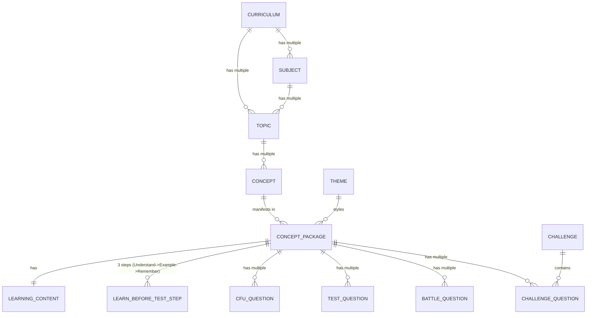

# Kidsverse Curriculum & Content Ingestion API Reference

This document provides the complete API specifications, segregated database schema architecture, payload schemas, and testing commands for feeding and managing curriculum content in the Kidsverse backend.

---

## 1. Relational Database Architecture & Hierarchy

Content is not bundled into a single JSON blob. It is cleanly segregated across dedicated relational tables:



### Table Breakdown

| Entity / Table | Model Name | Description & Segregation Role |
|---|---|---|
| `curriculums` | `Curriculum` | **Stored Separately**: Represents an educational syllabus (e.g. CBSE Grade 4, ICSE Grade 5). Contains `board`, `grade`, `name`, `code`, `is_active`. |
| `subjects` | `Subject` | Subjects linked to Curriculum via `curriculum_id` foreign key & `curricula` ManyToMany (e.g. Mathematics, Science). |
| `topics` | `Topic` | Topics bound to Curriculum and Subject (e.g. Fractions, Geometry, Number Systems). |
| `concepts` | `Concept` | Granular learning concepts under a topic (e.g. Equivalent Fractions) with learning objectives. Can belong to multiple themes. |
| `themes` | `Theme` | **Stored Separately**: Themes and interests (e.g. Space, Animals, Everyday Life, Robots) with `name`, `slug`, `icon_asset`. |
| `concept_packages` | `ConceptPackage` | Junction entity binding a `Concept` with a `Theme`. Storing metadata and raw payload backup. |
| `learning_contents` | `LearningContent` | **Segregated Table**: Teaching method, explanation, image asset URLs, image generation prompts, image alt text, pedagogical hints list, and Nova companion scripts/feedback. |
| `learn_before_test_steps` | `LearnBeforeTestStep` | **Segregated Table**: 3 progressive learning screens before quiz (`understand`, `example`, `remember`), each containing screen title, child-friendly teaching text, key idea takeaway, image url, prompt, image alt, Nova script, interactive mini-question check, and `explanation_ways` micro-scenarios. |
| `check_for_understanding_questions` | `CheckForUnderstandingQuestion` | **Segregated Table**: Check For Understanding (CFU) questions with options, answer, difficulty, explanation, marks, xp, hints, nova feedback, image url, image prompt, and image alt. |
| `concept_test_questions` | `ConceptTestQuestion` | **Segregated Table**: Assessment test questions with options, answer, difficulty, marks, xp, hints, nova feedback, image url, image prompt, and image alt. (Optional in new payload). |
| `battle_questions` | `BattleQuestion` | **Segregated Table**: Rapid-fire battle questions with XP reward, marks, options, answer, difficulty, explanation, hints, nova feedback, image url, image prompt, and image alt. |
| `challenges` & `challenge_questions` | `Challenge` / `ChallengeQuestion` | **Segregated Tables**: Boss challenges with questions containing XP, marks, options, correct answer, difficulty, hints, nova feedback, image url, image prompt, and image alt. |

---

## 2. API Endpoints Reference

### 2.1. Feed / Ingest Content Package

Ingests the complete JSON payload exported from the authoring studio. Automatically resolves or creates **Curriculum**, **Subject**, **Topic**, **Concept**, **Theme**, **ConceptPackage**, **LearningContent**, all segregated **Questions** (CFU, Test, Battle, Challenge), and synchronizes a playable **Mission** for students.

- **Method**: `POST`
- **URL**: `/api/v1/admin/content/feed`
- **Headers**: `Content-Type: application/json`

#### Request Body Example:
```json
{
  "curriculum": {
    "grade": "Grade 4",
    "board": "CBSE",
    "subject": "Mathematics",
    "topic": "Fractions"
  },
  "concept": {
    "name": "Equivalent Fractions",
    "learning_objective": "Understand that fractions that look different can represent the same value."
  },
  "theme_interest": "Space",
  "content_type": "concept_package",
  "learning_content": {
    "teaching_method": "Visual fuel tank partitioning in orbit",
    "image_url": "https://assets.kidsverse.app/concepts/space_fractions.png",
    "image_prompt": "Astronaut dividing fuel canisters into 4 equal segments",
    "explanation": "If an astronaut takes 2 out of 4 fuel pods (2/4), that is the exact same amount as half a fuel cell (1/2)!",
    "hints": [
      "Divide both the top and bottom number by 2.",
      "Look at the visual fuel gauge.",
      "Half of four is two."
    ],
    "nova_script": "Commander, look at the fuel reserves! Can you help calibrate them?",
    "nova_feedback": "Spectacular navigation! You have mastered equivalent fractions."
  },
  "learn_before_test": {
    "required": true,
    "order": [
      "understand",
      "example",
      "remember"
    ],
    "starts_quiz_after": "remember",
    "steps": [
      {
        "step_key": "understand",
        "title": "Introduce the idea: Fractions represent parts of a whole",
        "teaching_text": "Imagine a fuel tank divided into 4 equal pods. Taking 2 pods out of 4 (2/4) fills up the exact same amount of space as 1 pod out of 2 (1/2)!",
        "key_idea": "Fractions with different numbers can still describe the exact same amount.",
        "image_url": "https://assets.kidsverse.app/concepts/step1_understand_space_fractions.png",
        "image_prompt": "An astronaut floating in an orbiter comparing two glowing fuel tanks side-by-side, one split into two halves and one into four quarters, highlighting equal fluid levels",
        "nova_script": "Astronaut Nova here! Notice how both tanks have the same amount of fuel even though the lines are drawn differently?",
        "mini_question": {
          "question": "If you take 2 out of 4 equal fuel pods, how much of the tank do you have?",
          "options": [
            "Half the tank",
            "The entire tank",
            "One quarter"
          ],
          "answer": "Half the tank",
          "explanation": "2 out of 4 parts is half of the entire set of 4 parts."
        }
      },
      {
        "step_key": "example",
        "title": "Show it step by step: Multiplying or dividing top and bottom",
        "teaching_text": "Whenever you multiply or divide the top (numerator) and bottom (denominator) by the same number, the fraction stays equivalent. For example, 1/2 x (2/2) = 2/4!",
        "key_idea": "Multiplying or dividing top and bottom by the same number creates an equivalent fraction.",
        "image_url": "https://assets.kidsverse.app/concepts/step2_example_space_fractions.png",
        "image_prompt": "Futuristic chalkboard in space station showing 1/2 multiplying by 2/2 with arrows to form 2/4 with bright glowing holographic numbers",
        "nova_script": "Watch how we multiply top and bottom by 2. It’s like magic, but it’s math!",
        "mini_question": {
          "question": "What happens if you multiply both the numerator and denominator of 1/2 by 3?",
          "options": [
            "You get 3/6",
            "You get 3/2",
            "You get 1/6"
          ],
          "answer": "You get 3/6",
          "explanation": "1 x 3 = 3 and 2 x 3 = 6, so you get 3/6 which equals 1/2."
        }
      },
      {
        "step_key": "remember",
        "title": "Make it memorable: The Golden Rule of Fractions",
        "teaching_text": "Whatever you do to the top, you MUST do to the bottom! Keep them in balance and fractions will always stay equal.",
        "key_idea": "Always treat numerator and denominator equally to keep fractions balanced.",
        "image_url": "https://assets.kidsverse.app/concepts/step3_remember_space_fractions.png",
        "image_prompt": "A balance scale in a space laboratory holding the numerator on top and denominator on bottom in perfect equilibrium",
        "nova_script": "Remember the Golden Rule: Balance the top and bottom, and you’ll ace every quiz!",
        "mini_question": {
          "question": "What is the golden rule for keeping fractions equivalent?",
          "options": [
            "Do the same operation to both the top and bottom",
            "Only change the top number",
            "Always add 1 to the bottom"
          ],
          "answer": "Do the same operation to both the top and bottom",
          "explanation": "Changing both top and bottom by the same factor keeps the ratio identical."
        }
      }
    ]
  },
  "check_for_understanding": [
    {
      "question": "Which fraction is equivalent to 1/2?",
      "options": ["2/4", "1/3", "3/5", "4/6"],
      "answer": "2/4",
      "difficulty": "Easy",
      "explanation": "2/4 simplifies to 1/2 when dividing both by 2."
    }
  ],
  "test_questions": {
    "one_time": false,
    "questions": [
      {
        "question": "If a space pod uses 3/6 of its fuel, what fraction has it used?",
        "options": ["1/2", "1/3", "2/3", "3/4"],
        "answer": "1/2",
        "difficulty": "Medium",
        "marks": 1,
        "explanation": "3 divided by 3 is 1, and 6 divided by 3 is 2."
      }
    ]
  },
  "battle_questions": [
    {
      "question": "Quick battle: Is 4/8 equal to 1/2?",
      "options": ["Yes", "No"],
      "answer": "Yes",
      "difficulty": "Hard",
      "xp": 20,
      "explanation": "Both numerator and denominator can be divided by 4."
    }
  ],
  "challenge": {
    "one_time": false,
    "questions": [
      {
        "question": "Boss challenge: Find the missing numerator: ?/10 = 1/2",
        "options": ["5", "2", "4", "6"],
        "answer": "5",
        "difficulty": "Hard",
        "xp": 35,
        "explanation": "Half of 10 is 5.",
        "nova_feedback": "Incredible! You defeated the challenge!"
      }
    ]
  }
}
```

#### Success Response (`201 Created`):
```json
{
  "status": "success",
  "message": "Content package successfully ingested and segregated into relational tables",
  "data": {
    "curriculum_id": "c85d7bf2-97be-43a7-a5aa-952b75ecbcf8",
    "curriculum": "CBSE - Grade 4",
    "subject_id": "78794c48-fb9e-4e6f-a89c-851912442cf2",
    "subject": "Mathematics",
    "board": "CBSE",
    "grade": "Grade 4",
    "topic_id": "060d5b51-ce0b-4171-8ecb-99d63897f2ca",
    "topic": "Fractions",
    "concept_id": "42617f69-d754-472e-b6a8-bc6b4b4554ea",
    "concept": "Equivalent Fractions",
    "theme_id": "18f381c8-ebca-4976-a070-5b5358bf14ee",
    "theme": "Space",
    "package_id": "890d23c1-b0e2-45bb-b3b4-18c6428c9b32",
    "learning_content_id": "2d7b420c-519b-4e89-a1b4-7b6c5a0194bc",
    "mission_id": "727a3c31-1ee7-4560-bfdf-793ca0a831e5",
    "test_id": "80f12c34-9ab3-45cd-ef12-3456789abcde",
    "challenge_id": "90e23d45-0bc4-56de-f012-456789abcdef",
    "learn_before_test_steps_saved": 3,
    "questions_saved": {
      "cfu": 1,
      "test": 1,
      "battle": 1,
      "challenge": 1,
      "total": 4
    }
  }
}
```

---

### 2.2. List & Filter Content Packages

List all stored packages with filtering options.

- **Method**: `GET`
- **URL**: `/api/v1/admin/content/packages`
- **Query Parameters**:
  - `grade`: Filter by grade (e.g. `Grade 4`)
  - `board`: Filter by board (e.g. `CBSE`, `ICSE`)
  - `subject`: Filter by subject name (e.g. `Mathematics`)
  - `topic`: Filter by topic name (e.g. `Fractions`)
  - `theme`: Filter by theme (e.g. `Space`, `Animals`)
  - `curriculum_id`: Filter by Curriculum UUID

#### Success Response (`200 OK`):
```json
{
  "count": 1,
  "packages": [
    {
      "id": "890d23c1-b0e2-45bb-b3b4-18c6428c9b32",
      "concept_id": "42617f69-d754-472e-b6a8-bc6b4b4554ea",
      "concept_name": "Equivalent Fractions",
      "topic_name": "Fractions",
      "subject_name": "Mathematics",
      "grade": "Grade 4",
      "board": "CBSE",
      "theme": "Space",
      "content_type": "concept_package",
      "is_published": true,
      "question_count": 4,
      "created_at": "2026-09-12T12:00:00Z",
      "updated_at": "2026-09-12T12:00:00Z"
    }
  ]
}
```

---

### 2.3. Get Individual Package Detail

Retrieves the complete content package reconstructed from the segregated relational tables (`learning_contents`, `check_for_understanding_questions`, `concept_test_questions`, `battle_questions`, `challenge_questions`).

- **Method**: `GET`
- **URL**: `/api/v1/admin/content/packages/{package_id}`

#### Success Response (`200 OK`):
```json
{
  "id": "890d23c1-b0e2-45bb-b3b4-18c6428c9b32",
  "curriculum": {
    "id": "c85d7bf2-97be-43a7-a5aa-952b75ecbcf8",
    "grade": "Grade 4",
    "board": "CBSE",
    "subject": "Mathematics",
    "topic": "Fractions"
  },
  "concept": {
    "id": "42617f69-d754-472e-b6a8-bc6b4b4554ea",
    "name": "Equivalent Fractions",
    "learning_objective": "Understand that fractions that look different can represent the same value."
  },
  "theme_interest": "Space",
  "content_type": "concept_package",
  "learning_content": {
    "id": "2d7b420c-519b-4e89-a1b4-7b6c5a0194bc",
    "teaching_method": "Visual fuel tank partitioning in orbit",
    "image_url": "https://assets.kidsverse.app/concepts/space_fractions.png",
    "image_prompt": "Astronaut dividing fuel canisters into 4 equal segments",
    "explanation": "If an astronaut takes 2 out of 4 fuel pods (2/4), that is the exact same amount as half a fuel cell (1/2)!",
    "hints": [
      "Divide both the top and bottom number by 2.",
      "Look at the visual fuel gauge.",
      "Half of four is two."
    ],
    "nova_script": "Commander, look at the fuel reserves! Can you help calibrate them?",
    "nova_feedback": "Spectacular navigation! You have mastered equivalent fractions."
  },
  "learn_before_test": {
    "required": true,
    "order": [
      "understand",
      "example",
      "remember"
    ],
    "starts_quiz_after": "remember",
    "steps": [
      {
        "step_key": "understand",
        "title": "Introduce the idea: Fractions represent parts of a whole",
        "teaching_text": "Imagine a fuel tank divided into 4 equal pods. Taking 2 pods out of 4 (2/4) fills up the exact same amount of space as 1 pod out of 2 (1/2)!",
        "key_idea": "Fractions with different numbers can still describe the exact same amount.",
        "image_url": "https://assets.kidsverse.app/concepts/step1_understand_space_fractions.png",
        "image_prompt": "An astronaut floating in an orbiter comparing two glowing fuel tanks side-by-side, one split into two halves and one into four quarters, highlighting equal fluid levels",
        "nova_script": "Astronaut Nova here! Notice how both tanks have the same amount of fuel even though the lines are drawn differently?",
        "mini_question": {
          "question": "If you take 2 out of 4 equal fuel pods, how much of the tank do you have?",
          "options": [
            "Half the tank",
            "The entire tank",
            "One quarter"
          ],
          "answer": "Half the tank",
          "explanation": "2 out of 4 parts is half of the entire set of 4 parts."
        }
      },
      {
        "step_key": "example",
        "title": "Show it step by step: Multiplying or dividing top and bottom",
        "teaching_text": "Whenever you multiply or divide the top (numerator) and bottom (denominator) by the same number, the fraction stays equivalent. For example, 1/2 x (2/2) = 2/4!",
        "key_idea": "Multiplying or dividing top and bottom by the same number creates an equivalent fraction.",
        "image_url": "https://assets.kidsverse.app/concepts/step2_example_space_fractions.png",
        "image_prompt": "Futuristic chalkboard in space station showing 1/2 multiplying by 2/2 with arrows to form 2/4 with bright glowing holographic numbers",
        "nova_script": "Watch how we multiply top and bottom by 2. It’s like magic, but it’s math!",
        "mini_question": {
          "question": "What happens if you multiply both the numerator and denominator of 1/2 by 3?",
          "options": [
            "You get 3/6",
            "You get 3/2",
            "You get 1/6"
          ],
          "answer": "You get 3/6",
          "explanation": "1 x 3 = 3 and 2 x 3 = 6, so you get 3/6 which equals 1/2."
        }
      },
      {
        "step_key": "remember",
        "title": "Make it memorable: The Golden Rule of Fractions",
        "teaching_text": "Whatever you do to the top, you MUST do to the bottom! Keep them in balance and fractions will always stay equal.",
        "key_idea": "Always treat numerator and denominator equally to keep fractions balanced.",
        "image_url": "https://assets.kidsverse.app/concepts/step3_remember_space_fractions.png",
        "image_prompt": "A balance scale in a space laboratory holding the numerator on top and denominator on bottom in perfect equilibrium",
        "nova_script": "Remember the Golden Rule: Balance the top and bottom, and you’ll ace every quiz!",
        "mini_question": {
          "question": "What is the golden rule for keeping fractions equivalent?",
          "options": [
            "Do the same operation to both the top and bottom",
            "Only change the top number",
            "Always add 1 to the bottom"
          ],
          "answer": "Do the same operation to both the top and bottom",
          "explanation": "Changing both top and bottom by the same factor keeps the ratio identical."
        }
      }
    ]
  },
  "check_for_understanding": [
    {
      "question": "Which fraction is equivalent to 1/2?",
      "options": ["2/4", "1/3", "3/5", "4/6"],
      "answer": "2/4",
      "difficulty": "Easy",
      "explanation": "2/4 simplifies to 1/2 when dividing both by 2."
    }
  ],
  "test_questions": {
    "one_time": false,
    "questions": [
      {
        "question": "If a space pod uses 3/6 of its fuel, what fraction has it used?",
        "options": ["1/2", "1/3", "2/3", "3/4"],
        "answer": "1/2",
        "difficulty": "Medium",
        "marks": 1,
        "explanation": "3 divided by 3 is 1, and 6 divided by 3 is 2."
      }
    ]
  },
  "battle_questions": [
    {
      "question": "Quick battle: Is 4/8 equal to 1/2?",
      "options": ["Yes", "No"],
      "answer": "Yes",
      "difficulty": "Hard",
      "xp": 20,
      "explanation": "Both numerator and denominator can be divided by 4."
    }
  ],
  "challenge": {
    "one_time": false,
    "questions": [
      {
        "question": "Boss challenge: Find the missing numerator: ?/10 = 1/2",
        "options": ["5", "2", "4", "6"],
        "answer": "5",
        "difficulty": "Hard",
        "xp": 35,
        "explanation": "Half of 10 is 5.",
        "nova_feedback": "Incredible! You defeated the challenge!"
      }
    ]
  },
  "created_at": "2026-09-12T12:00:00Z",
  "updated_at": "2026-09-12T12:00:00Z"
}
```

---

### 2.4. Curriculum Hierarchy Tree

Returns the curriculum hierarchy (Curriculum -> Subjects -> Topics -> Concepts -> Available Themes).

- **Method**: `GET`
- **URL**: `/api/v1/curriculum/tree`
- **Query Parameters**:
  - `grade` (optional): e.g. `Grade 4`
  - `board` (optional): e.g. `CBSE`
  - `subject` (optional): e.g. `Mathematics`
  - `curriculum_id` (optional): Filter by Curriculum UUID

#### Success Response (`200 OK`):
```json
{
  "filter": {
    "grade": "Grade 4",
    "board": "CBSE",
    "subject": "Mathematics",
    "curriculum_id": null
  },
  "count": 1,
  "topics": [
    {
      "id": "060d5b51-ce0b-4171-8ecb-99d63897f2ca",
      "curriculum_id": "c85d7bf2-97be-43a7-a5aa-952b75ecbcf8",
      "name": "Fractions",
      "slug": "fractions",
      "subject": "Mathematics",
      "grade": "Grade 4",
      "board": "CBSE",
      "concepts": [
        {
          "id": "42617f69-d754-472e-b6a8-bc6b4b4554ea",
          "name": "Equivalent Fractions",
          "slug": "equivalent-fractions",
          "objective": "Understand that fractions that look different can represent the same value.",
          "available_themes": [
            "Space",
            "Animals"
          ]
        }
      ]
    }
  ]
}
```

---

### 2.5. Curriculum Management APIs

#### List Curriculums
- **Method**: `GET`
- **URL**: `/api/v1/curriculums`
- **Query Parameters**: `board`, `grade`

#### Create Curriculum
- **Method**: `POST`
- **URL**: `/api/v1/curriculums`
- **Body**:
  ```json
  {
    "board": "CBSE",
    "grade": "Grade 5",
    "name": "CBSE - Grade 5",
    "description": "CBSE syllabus for standard 5"
  }
  ```

#### Get Curriculum Detail
- **Method**: `GET`
- **URL**: `/api/v1/curriculums/{curriculum_id}`
- Returns curriculum details with list of subjects and topics.

#### Add Subject to Curriculum
- **Method**: `POST`
- **URL**: `/api/v1/curriculums/{curriculum_id}/subjects`
- **Body**:
  ```json
  {
    "name": "Science"
  }
  ```

---

### 2.6. Topic & Concept Management

#### Add Concept to Topic
- **Method**: `POST`
- **URL**: `/api/v1/topics/{topic_id}/concepts`
- **Body**:
  ```json
  {
    "name": "Adding Like Fractions",
    "learning_objective": "Learn to add fractions with identical denominators."
  }
  ```

---

### 2.7. Themes Management

#### List Themes
- **Method**: `GET`
- **URL**: `/api/v1/themes`

#### Create Theme
- **Method**: `POST`
- **URL**: `/api/v1/themes`
- **Body**:
  ```json
  {
    "name": "Robots",
    "description": "Futuristic robotics and cybernetic companions"
  }
  ```

---

## 3. How to Test via cURL Commands

Ensure the Django server is running (`python manage.py runserver`).

### Test 1: Ingest a Content Package
```bash
curl -X POST "http://127.0.0.1:8000/api/v1/admin/content/feed" \
  -H "Content-Type: application/json" \
  -d '{
    "curriculum": {
      "grade": "Grade 4",
      "board": "CBSE",
      "subject": "Mathematics",
      "topic": "Fractions"
    },
    "concept": {
      "name": "Equivalent Fractions",
      "learning_objective": "Understand how 1/2 equals 2/4 visually"
    },
    "theme_interest": "Space",
    "content_type": "concept_package",
    "learning_content": {
      "teaching_method": "Visual fuel tank partitioning in orbit",
      "image_url": "https://assets.kidsverse.app/concepts/space_fractions.png",
      "image_prompt": "Astronaut dividing fuel canisters into 4 equal segments",
      "explanation": "Taking 2 out of 4 fuel pods (2/4) is equal to half a fuel cell (1/2)!",
      "hints": ["Divide top and bottom by 2", "Half of four is two"],
      "nova_script": "Commander, calibrate the fuel reserves!",
      "nova_feedback": "Spectacular navigation!"
    },
    "learn_before_test": {
      "required": true,
      "order": ["understand", "example", "remember"],
      "starts_quiz_after": "remember",
      "steps": [
        {
          "step_key": "understand",
          "title": "Introduce the idea: Fractions represent parts of a whole",
          "teaching_text": "Imagine a fuel tank divided into 4 equal pods. Taking 2 pods out of 4 (2/4) fills up the exact same amount of space as 1 pod out of 2 (1/2)!",
          "key_idea": "Fractions with different numbers can still describe the exact same amount.",
          "image_url": "https://assets.kidsverse.app/concepts/step1_understand_space_fractions.png",
          "image_prompt": "An astronaut floating in an orbiter comparing two glowing fuel tanks side-by-side, one split into two halves and one into four quarters",
          "nova_script": "Notice how both tanks have the same amount of fuel even though the lines are drawn differently?",
          "mini_question": {
            "question": "If you take 2 out of 4 equal fuel pods, how much of the tank do you have?",
            "options": ["Half the tank", "The entire tank", "One quarter"],
            "answer": "Half the tank",
            "explanation": "2 out of 4 parts is half of the entire set of 4 parts."
          }
        },
        {
          "step_key": "example",
          "title": "Show it step by step: Multiplying or dividing top and bottom",
          "teaching_text": "Whenever you multiply or divide top and bottom by the same number, the fraction stays equivalent. 1/2 x (2/2) = 2/4!",
          "key_idea": "Multiplying or dividing top and bottom by the same number creates an equivalent fraction.",
          "image_url": "https://assets.kidsverse.app/concepts/step2_example_space_fractions.png",
          "image_prompt": "Futuristic chalkboard in space station showing 1/2 multiplying by 2/2 with arrows to form 2/4",
          "nova_script": "Watch how we multiply top and bottom by 2. It’s like magic, but it’s math!",
          "mini_question": {
            "question": "What happens if you multiply both numerator and denominator of 1/2 by 3?",
            "options": ["You get 3/6", "You get 3/2", "You get 1/6"],
            "answer": "You get 3/6",
            "explanation": "1 x 3 = 3 and 2 x 3 = 6, yielding 3/6."
          }
        },
        {
          "step_key": "remember",
          "title": "Make it memorable: The Golden Rule of Fractions",
          "teaching_text": "Whatever you do to the top, you MUST do to the bottom! Keep them in balance and fractions will always stay equal.",
          "key_idea": "Always treat numerator and denominator equally to keep fractions balanced.",
          "image_url": "https://assets.kidsverse.app/concepts/step3_remember_space_fractions.png",
          "image_prompt": "A balance scale in a space laboratory holding the numerator on top and denominator on bottom in perfect equilibrium",
          "nova_script": "Remember the Golden Rule: Balance the top and bottom, and you’ll ace every quiz!",
          "mini_question": {
            "question": "What is the golden rule for keeping fractions equivalent?",
            "options": [
              "Do the same operation to both the top and bottom",
              "Only change the top number",
              "Always add 1 to the bottom"
            ],
            "answer": "Do the same operation to both the top and bottom",
            "explanation": "Changing both top and bottom by the same factor keeps the ratio identical."
          }
        }
      ]
    },
    "check_for_understanding": [
      {
        "question": "Which fraction is equal to 1/2?",
        "options": ["2/4", "1/3", "3/5", "4/6"],
        "answer": "2/4",
        "difficulty": "Easy",
        "explanation": "2/4 simplifies to 1/2."
      }
    ],
    "test_questions": {
      "one_time": false,
      "questions": [
        {
          "question": "What fraction of fuel is 3/6?",
          "options": ["1/2", "1/3", "2/3"],
          "answer": "1/2",
          "difficulty": "Medium",
          "marks": 1,
          "explanation": "3/6 reduces to 1/2."
        }
      ]
    },
    "battle_questions": [
      {
        "question": "Is 4/8 equal to 1/2?",
        "options": ["Yes", "No"],
        "answer": "Yes",
        "difficulty": "Hard",
        "xp": 20,
        "explanation": "Divide numerator and denominator by 4."
      }
    ],
    "challenge": {
      "one_time": false,
      "questions": [
        {
          "question": "Solve: ?/10 = 1/2",
          "options": ["5", "2", "4"],
          "answer": "5",
          "difficulty": "Hard",
          "xp": 35,
          "explanation": "Half of 10 is 5.",
          "nova_feedback": "You defeated the challenge!"
        }
      ]
    }
  }'
```

### Test 2: Ingest the Same Concept under a Second Theme ("Animals")
```bash
curl -X POST "http://127.0.0.1:8000/api/v1/admin/content/feed" \
  -H "Content-Type: application/json" \
  -d '{
    "curriculum": {
      "grade": "Grade 4",
      "board": "CBSE",
      "subject": "Mathematics",
      "topic": "Fractions"
    },
    "concept": {
      "name": "Equivalent Fractions",
      "learning_objective": "Understand how 1/2 equals 2/4 visually"
    },
    "theme_interest": "Animals",
    "content_type": "concept_package",
    "learning_content": {
      "teaching_method": "Jungle safari pizza division",
      "explanation": "Monkeys dividing fruit into equal shares",
      "hints": ["Each monkey gets an equal portion"],
      "nova_script": "Look at the animals sharing!",
      "nova_feedback": "Great animal care!"
    },
    "check_for_understanding": [
      {
        "question": "Which animal share represents 1/2?",
        "options": ["2/4", "1/5"],
        "answer": "2/4",
        "difficulty": "Easy",
        "explanation": "2 out of 4 is half."
      }
    ],
    "test_questions": {
      "questions": [
        {
          "question": "How much fruit is 2/4?",
          "options": ["Half", "Quarter"],
          "answer": "Half",
          "difficulty": "Easy",
          "marks": 1,
          "explanation": "2/4 equals 1/2."
        }
      ]
    },
    "battle_questions": [],
    "challenge": { "questions": [] }
  }'
```

### Test 3: List Curriculums
```bash
curl "http://127.0.0.1:8000/api/v1/curriculums"
```

### Test 4: List Packages by Grade, Board, and Theme
```bash
curl "http://127.0.0.1:8000/api/v1/admin/content/packages?grade=Grade+4&board=CBSE&theme=Space"
```

### Test 5: Get Complete Package Detail
*(Replace `<PACKAGE_ID>` with the `package_id` returned from Test 1)*
```bash
curl "http://127.0.0.1:8000/api/v1/admin/content/packages/<PACKAGE_ID>"
```

### Test 6: Query Curriculum Tree
```bash
curl "http://127.0.0.1:8000/api/v1/curriculum/tree?grade=Grade+4&board=CBSE"
```

### Test 7: List All Themes
```bash
curl "http://127.0.0.1:8000/api/v1/themes"
```
